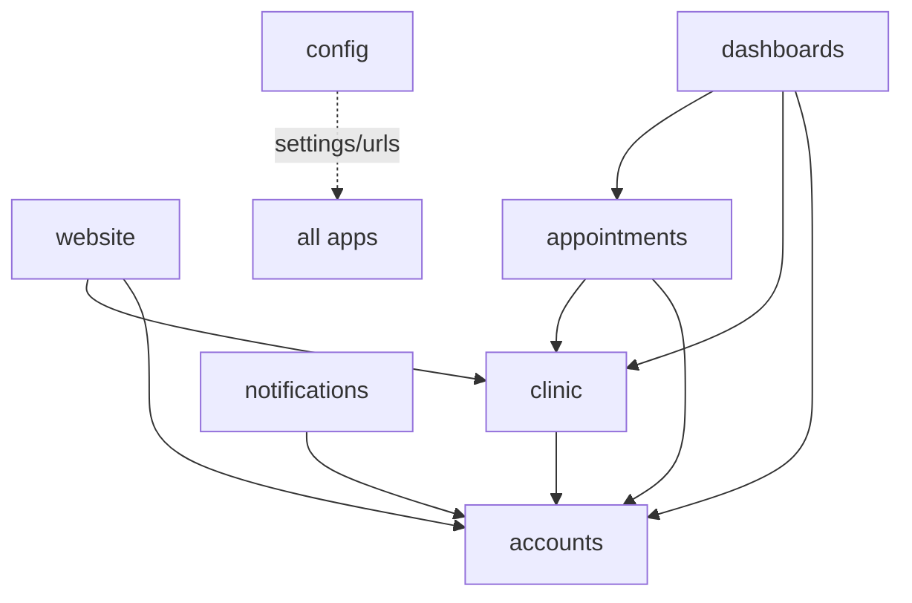
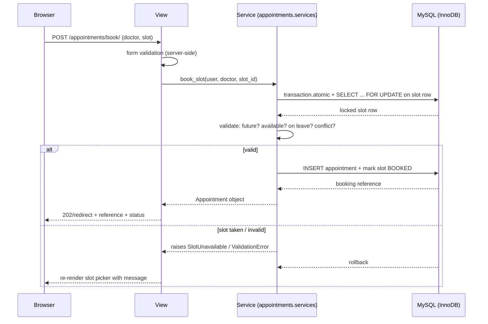

# Architecture — Care_Clinic

**Phase:** 1 — Architecture (planning only)
**Stack:** Python 3.12 · Django 5.2 LTS · MySQL (InnoDB) · mysqlclient · Django Templates ·
HTML/CSS/Bootstrap 5/vanilla JS · Django ORM · Git/GitHub

**Non-negotiables:** server-rendered Django only. No React, Next.js, microservices,
message brokers, or extra infrastructure. Nothing in this document implies code exists yet.

---

## 1. Architecture style

A **modular monolith** with server-rendered pages:

- One deployable Django project, split into small, single-purpose apps.
- Business rules live in a **service layer**, not in views or templates.
- All authorization is enforced on the backend (views, services, and querysets).
- Clear separation: **presentation (templates) → views (HTTP) → services (rules) → models (state)**.

## 2. Project layout

```
config/                     # project package (no domain logic)
  settings/base.py          # base settings
  settings/dev.py           # local/dev overrides
  settings/prod.py          # production overrides
  urls.py, wsgi.py, asgi.py
apps/
  accounts/                 # custom User, roles, profiles, auth, permissions
  clinic/                   # Speciality, Doctor, AvailabilityRule, DoctorLeave
  appointments/             # AppointmentSlot, Appointment + booking services
  dashboards/               # role-scoped dashboard views (thin)
  website/                  # public pages (home, specialities, doctors, contact)
  notifications/            # OPTIONAL; in-app notices (deferred)
templates/  static/  media/  docs/  tests/
```

### 2.1 Evaluation and justified modifications to the proposed app list

| App | Verdict | Notes |
|---|---|---|
| `accounts` | Keep | Owns `User` (custom), profiles, role helpers, permission mixins/decorators. |
| `clinic` | Keep | Catalog + scheduling configuration only (no booking logic). |
| `appointments` | Keep, strengthen | Add explicit `services.py` (writes) and `selectors.py` (scoped reads). This is where booking integrity lives. |
| `dashboards` | Keep, thin | Presentation only; delegates to services/selectors. Contains no business rules. |
| `website` | Keep | Read-only public pages; benefits from `clinic` selectors. |
| `notifications` | Keep, defer | In-app only in v1, behind a small interface so email/SMS can be added later. Not blocking v1. |
| `config` | **Add** (new) | Settings package + root URLs. Keeps the project runnable and testable without polluting apps. |

**Rejected additions:** a shared `core` app (defer until a second consumer exists — avoids
a junk drawer), and any API/DRF layer (server-rendered pages only).

### 2.2 Dependency rules (allowed direction)



Hard rules: no circular imports; `accounts` imports nothing app-specific; `clinic` never
imports `appointments`; cross-app writes go through services.

## 3. Layering and request flow



## 4. URL map (proposed)

| Area | Paths |
|---|---|
| Public | `/`, `/specialities/`, `/specialities/<slug>/`, `/doctors/`, `/doctors/<slug>/`, `/contact/`, `/about/`, `/faq/` |
| Auth | `/accounts/login/`, `/accounts/logout/`, `/accounts/register/` (patient only), `/accounts/password-reset/` |
| Booking | `/appointments/book/`, `/appointments/<ref>/`, `/appointments/<ref>/cancel/`, `/appointments/<ref>/reschedule/`, `/appointments/slots/` (AJAX slot fetch) |
| Patient | `/dashboard/patient/` |
| Doctor | `/dashboard/doctor/`, `/dashboard/doctor/availability/`, `/dashboard/doctor/leave/` |
| Receptionist | `/dashboard/reception/`, `/dashboard/reception/book/` |
| Admin | `/dashboard/admin/`, `/dashboard/admin/doctors/`, `/dashboard/admin/specialities/`, `/dashboard/admin/users/` |
| Admin (Django) | `/manage/` (staff/superuser only, separate from app dashboards) |

## 5. Booking workflow (integrity design)

Steps 1–5 (speciality → doctor → date → slot list → select slot) are read-only. Steps 6–9
are the integrity-critical path:

6. **Validate on server:** slot exists; start time is in the future; within an availability
   rule; not on doctor leave; doctor is accepting appointments; slot still free.
7. **Reserve safely:** `transaction.atomic()` + `select_for_update()` on the slot row.
8. **Create appointment** and mark the slot `BOOKED` in the same transaction.
9. **Return** a booking reference and status (`REQUESTED` or `CONFIRMED` per Q1).

**Defense layers against double booking**

1. Application check inside a transaction (fast, friendly error).
2. `SELECT ... FOR UPDATE` row lock (serializes concurrent claims of the same slot).
3. Database **unique constraints** as the final guarantee (see `data-model.md` §6).
4. `IntegrityError` caught → clean "slot just taken" message + refreshed slot list.

**Error handling principles:** never trust the client; re-validate in the service even if
the view validated; every mutation wrapped in a transaction; illegal state transitions
rejected (e.g. cancelling a `COMPLETED` appointment).

## 6. RBAC matrix (backend-enforced)

| Capability | Patient | Doctor | Receptionist | Admin |
|---|:--:|:--:|:--:|:--:|
| View public site | ✅ | ✅ | ✅ | ✅ |
| Register (self) | ✅ Patient only | ❌ | ❌ | ❌ |
| Book for self | ✅ | ❌ | ❌ | ❌ |
| Book on behalf of a patient | ❌ | ❌ | ✅ | ✅ |
| View own appointments | ✅ own only | ✅ own schedule | — | — |
| View all appointments | ❌ | ❌ | ✅ | ✅ |
| Cancel/reschedule (own) | ✅ within window | ❌ | — | — |
| Cancel/reschedule (any) | ❌ | ❌ | ✅ | ✅ |
| Update appointment status | ❌ | ✅ own schedule | ✅ | ✅ |
| Manage own availability/leave | ❌ | ✅ | ❌ | ✅ |
| Manage doctors | ❌ | ❌ | ❌ | ✅ |
| Manage specialities | ❌ | ❌ | ❌ | ✅ |
| Manage users and roles | ❌ | ❌ | ❌ | ✅ |
| Django `/manage/` admin | ❌ | ❌ | ❌ | ✅ staff/superuser |

### 6.1 Enforcement mechanisms (not just hidden buttons)

- **Scoped querysets** everywhere: `Appointment.objects.for_user(request.user)` filters by
  role and ownership (Patient → own; Doctor → own schedule; staff → all).
- **Object access** uses the scoped queryset (`get_object_or_404`), so unauthorized IDs
  return **404**, preventing enumeration.
- **Role decorators/mixins** (`role_required`, `RoleRequiredMixin`) gate view classes.
- **Service-layer re-checks** inside transactions (defense in depth).
- **Group-based permissions** (Django `Permission`) for coarse capabilities; object-level
  scoping for record ownership.
- **Registration form** hard-codes `role=PATIENT`; role is never accepted from input.

## 7. Security requirements

- `SECRET_KEY`, DB credentials, and email credentials only via environment (`.env`,
  git-ignored). `.env.example` documents placeholders.
- `DEBUG=False` and explicit `ALLOWED_HOSTS` outside development.
- HTTPS-ready: `SESSION_COOKIE_SECURE`, `CSRF_COOKIE_SECURE`, HSTS flags in prod settings.
- CSRF protection on all POST forms; XSS-safe templating (auto-escaping, no `|safe` on user input).
- Django's ORM only (no raw SQL); `django.middleware.common` security middleware defaults kept.
- Password validators enabled; least-privilege DB user.
- PII minimization: v1 stores contact details only — **no clinical/medical records**.
- Input validation server-side on every form; length/type checks; slug/regex-safe URLs.
- Dev-only tooling (`bandit`, `pip-audit`) run in the testing phase, not in production path.

## 8. Frontend design direction (planning only — nothing built yet)

> **When UI implementation begins, the `frontend-design` skill MUST be loaded and
> followed.** A `web-design-guidelines` audit will be run before delivery.

### 8.1 Visual direction — "Calm clinical clarity"

- **Original** healthcare identity (no reference-site branding, logos, text, or images).
- Palette: deep teal/slate primary, warm off-white surfaces, one accessible accent for
  CTAs (WCAG AA contrast); status colors reserved strictly for appointment states.
- Typography: one humanist sans for UI, one for headings; generous whitespace; large tap targets.
- Imagery: original CSS/SVG placeholders and abstract medical motifs only.
- Bootstrap 5 grid/components as the base, customized via CSS variables (no heavy theme).

### 8.2 Screen plan

| Screen | Purpose & key components |
|---|---|
| **Homepage** | Hero + primary "Book Appointment" CTA, speciality grid, featured doctors, trust stats, hours/contact strip. |
| **Doctor listing** | Search + speciality filter, doctor cards (photo placeholder, name, quals, speciality), Book CTA. |
| **Doctor profile** | Bio, speciality, availability summary, Book CTA, contact block. |
| **Speciality listing/detail** | Grid → detail with description and its doctors. |
| **Appointment booking** | 4-step stepper (speciality → doctor → date → slot), live slot grid, clear server-side validation messages, confirmation screen with reference + status. |
| **Patient dashboard** | Upcoming/past tabs, appointment cards with status badges, reschedule/cancel actions. |
| **Doctor dashboard** | Today's schedule list, per-appointment status actions, availability/leave management forms. |
| **Receptionist dashboard** | Day view, book-on-behalf form, patient lookup, check-in/confirm/cancel actions. |
| **Admin dashboard** | Management tables (doctors, specialities, users), appointment oversight, simple counts. |

### 8.3 Shared UI components

Role-aware navbar/sidebar; appointment status badge; slot grid; stepper; empty states;
flash/alert messages; labeled forms with inline validation feedback; accessible focus states.

## 9. Technology decisions summary

See `decisions.md` for full ADRs. Headline: modular monolith, custom `User` with `role`
declared as `AUTH_USER_MODEL` **before the first migration**, concrete `AppointmentSlot`
rows with unique constraints, and a transactional service layer with row locking.
