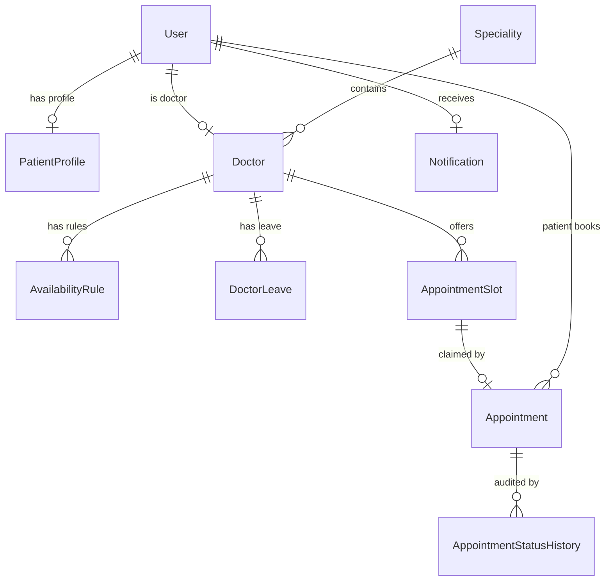
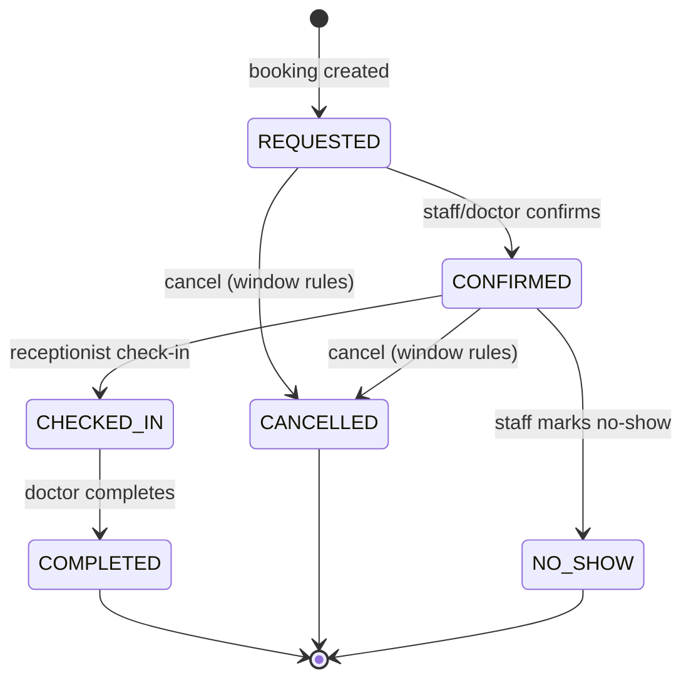

# Data Model — Care_Clinic

**Phase:** 1 — Data model (planning only; no migrations created)

**Critical pre-migration decision:** the custom user model (`accounts.User`) must be set as
`AUTH_USER_MODEL` **before the first migration is generated**. Changing it afterwards is
painful and error-prone. This is a Phase 2 gate.

---

## 1. Conventions

- Timezone-aware datetimes (`USE_TZ=True`), `Asia/Kolkata`.
- Integer primary keys internally; appointments carry a separate human-readable
  `reference` (e.g. `CC-2026-000123`) for support and display.
- Soft status transitions rather than hard deletes for appointments (auditability).
- InnoDB engine; `utf8mb4` charset.

## 2. Entity relationship diagram

## 3. Entities

### 3.1 `accounts.User` (extends `AbstractUser`) — `AUTH_USER_MODEL`

| Field | Type | Notes |
|---|---|---|
| `id` | PK | auto |
| `username` | unique | inherited, required |
| `email` | unique, indexed | required, verified-format |
| `first_name`, `last_name` | varchar | inherited |
| `password` | hashed | never stored/returned in plaintext |
| `role` | char, choices | `PATIENT` / `DOCTOR` / `RECEPTIONIST` / `ADMIN`; **default `PATIENT`** |
| `phone` | varchar(20), nullable | contact |
| `is_active`, `is_staff`, `is_superuser` | bool | Django semantics; staff/superuser only for Admin |
| `date_joined`, `last_login` | datetime | inherited |

**Validation / rules**
- `role` cannot be set from any public form; registration forces `PATIENT`.
- Creating Doctor/Receptionist/Admin users is admin-only (protected flow/management command).
- Promoting/demoting a role is an explicit admin action, audited.

### 3.2 `accounts.PatientProfile`

| Field | Type | Notes |
|---|---|---|
| `user` | OneToOne → User | parent, cascade |
| `date_of_birth` | date, nullable | |
| `address` | text, nullable | |
| `emergency_contact` | varchar(20), nullable | |
| `blood_group` | varchar(5), nullable | optional, non-clinical |

### 3.3 `clinic.Speciality`

| Field | Type | Notes |
|---|---|---|
| `name` | varchar(120), unique | e.g. "Cardiology" |
| `slug` | unique, indexed | URL key, ASCII, auto from name |
| `description` | text | public copy |
| `is_active` | bool | hidden when false |
| `created_at`, `updated_at` | datetime | audit |

### 3.4 `clinic.Doctor`

| Field | Type | Notes |
|---|---|---|
| `user` | OneToOne → User | parent |
| `speciality` | FK → Speciality, `PROTECT` | required |
| `registration_number` | varchar(50), unique | credentials |
| `qualification` | varchar(120) | e.g. "MBBS, MD" |
| `bio` | text | public |
| `profile_image` | image, nullable | optional |
| `slot_length_minutes` | int, default 30 | per-doctor override (Q11) |
| `is_accepting_appointments` | bool, default True | operational switch |
| `created_at`, `updated_at` | datetime | audit |

**Indexes:** `speciality_id`, `is_accepting_appointments`.

### 3.5 `clinic.AvailabilityRule`

Defines recurring weekly windows from which slots are materialized.

| Field | Type | Notes |
|---|---|---|
| `doctor` | FK → Doctor, cascade | |
| `weekday` | smallint, 0–6 | Monday=0 |
| `start_time` | time | window start |
| `end_time` | time | window end |
| `slot_length_minutes` | int, nullable | falls back to doctor default |
| `is_active` | bool | |

**Constraints:** `CheckConstraint(start_time < end_time)`; no overlapping windows per
doctor/weekday (enforced in service + validated on save).

### 3.6 `clinic.DoctorLeave`

| Field | Type | Notes |
|---|---|---|
| `doctor` | FK → Doctor, cascade | |
| `start_date`, `end_date` | date | inclusive |
| `reason` | varchar(255) | |
| `created_at` | datetime | |

**Constraint:** `CheckConstraint(start_date <= end_date)`. Creating leave must not silently
delete existing future bookings — service blocks or flags affected appointments.

### 3.7 `appointments.AppointmentSlot`

Concrete, bookable time slots (materialized from rules for a date window, e.g. by a
management command or lazily on demand).

| Field | Type | Notes |
|---|---|---|
| `doctor` | FK → Doctor, cascade | |
| `date` | date | denormalized for fast queries |
| `start_time` | time | |
| `end_time` | time | |
| `status` | choices | `OPEN` / `BOOKED` / `BLOCKED` |
| `created_at` | datetime | |

**Constraints / indexes**
- **`UniqueConstraint(doctor, date, start_time)`** — a doctor cannot have two identical slots.
- Check: `start_time < end_time`.
- Index: `(doctor, date, status)` for the slot-picker query.

> **Implemented (Phase 5, ADR-016):** slots are materialized from active rules by the
> idempotent `generate_slots` command/service (never lazily on demand); leave and past
> intervals are excluded at generation time.

### 3.8 `appointments.Appointment`

| Field | Type | Notes |
|---|---|---|
| `reference` | unique, indexed | human-readable booking reference |
| `patient` | FK → User (role=PATIENT) | `PROTECT` |
| `doctor` | FK → Doctor | `PROTECT` |
| `slot` | OneToOne → AppointmentSlot | `PROTECT`, **nullable**; guarantees one *active* appointment per slot |
| `date` | date | snapshot for reporting |
| `start_time`, `end_time` | time | snapshot |
| `status` | choices | see §4 |
| `reason` | varchar(255), nullable | visit reason (non-clinical) |
| `booked_by` | FK → User, nullable | who created it (patient self vs receptionist) |
| `cancelled_by` | FK → User, nullable | |
| `cancellation_reason` | varchar(255), nullable | |
| `created_at`, `updated_at` | datetime | audit |

**Constraints / indexes**
- Check: `start_time < end_time`.
- Index: `(doctor, date)`, `(patient, date)`, `(status)`.
- **Conditional unique** `(doctor, date, start_time)` where `status IN
  (REQUESTED, CONFIRMED, CHECKED_IN)` — belt-and-braces double-booking guard.

> **Implemented (Phase 5, ADR-017):** the conditional unique above is **not used** — Django
> silently skips conditional `UniqueConstraint`s on backends without partial-index support
> (notably MySQL). Instead `slot` is **nullable** and cancellation/rescheduling detaches it
> (`slot = NULL`), so the plain unique index on `slot` covers only the active booking. This is
> a hard, portable guarantee. Status transitions follow the state machine in §4.

### 3.9 Optional (deferred but planned)

- `notifications.Notification` — in-app messages (user FK, message, is_read).
- `appointments.AppointmentStatusHistory` — append-only audit of status transitions.

## 4. Appointment status state machine

Terminal states (`COMPLETED`, `CANCELLED`, `NO_SHOW`) cannot transition further.
Cancellation and rescheduling release the slot atomically.

## 5. Roles, groups, and permissions

- Coarse capabilities are Django `Permission` objects assigned to **Groups**:
  `Patients`, `Doctors`, `Receptionists`, `Admins`.
- The `role` field drives dashboard routing and queryset scoping; Groups provide
  capability checks. Both must agree (enforced by a service/management command that keeps
  them in sync).
- Record ownership is enforced in querysets, not by Group alone.

## 6. Concurrency & integrity summary

| Risk | Countermeasure |
|---|---|
| Double booking under concurrency | Transaction + `select_for_update` + unique constraints + `IntegrityError` handling |
| Booking past/invalid time | Server-side validation in service layer |
| Booking an unavailable slot | `AppointmentSlot.status` check inside lock |
| Booking on leave | `DoctorLeave` range check |
| IDOR on appointment records | Scoped querysets per role |
| Lost update on reschedule | Single transaction releases old slot and claims new slot |

## 7. Migration strategy

1. Create `accounts.User` and set `AUTH_USER_MODEL` **first**.
2. Generate initial migrations for `accounts`, then `clinic`, then `appointments`.
3. Seed data (specialities, availability rules) via a management command — not raw SQL.
4. Never edit a applied migration by hand; add a new one.
